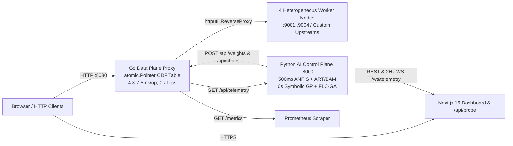
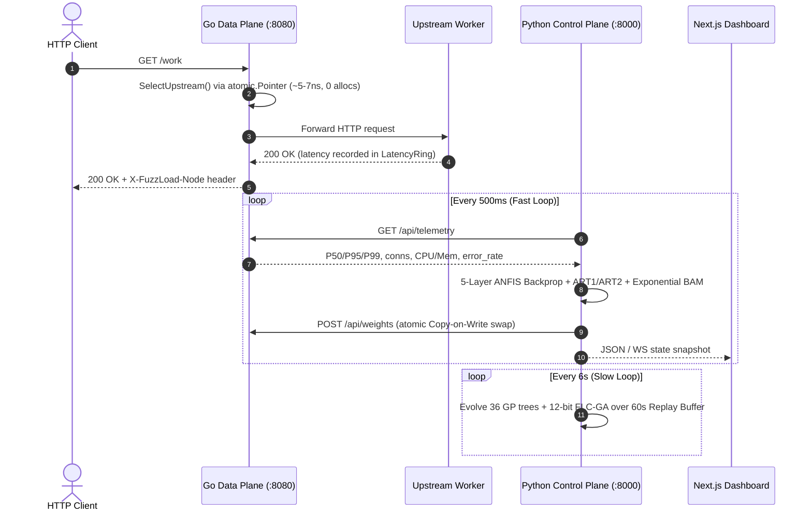

# FuzzLoad — Architecture

---

## 1. Stack & Runtime Versions

| Layer | Technology & Version | Runtime / Region / Notes |
|---|---|---|
| Frontend Dashboard | Next.js 16 (App Router) · React 19 · TypeScript · Tailwind CSS 3 · Recharts 3 | Node 22.x · Vercel (`bom1`) · `frontend/vercel.json` security headers |
| Data Plane & Go SDK | Go 1.23 (`net/http/httputil.ReverseProxy` · `sync/atomic.Pointer` · `LatencyRing`) | Published at `proxy-go/pkg/fuzzload@v1.0.0` (`4.8–7.5 ns/op`, `0 allocs/op`) |
| AI Control Plane & Python SDK | Python 3.12 · FastAPI · Pydantic v2 · Uvicorn · 5-Layer ANFIS · Symbolic GP · ART1/ART2/BAM | Installable package `fuzzload` + CLI `fuzzload start \| probe \| bench` |
| Testing & Security | `go test -race` · `pytest` · `ruff` · `tsc --noEmit` · CodeQL (Go/Python/JS) · Gitleaks v3 | Enforced on every push and PR via `.github/workflows/` |
| Hosting & Automation | Vercel (Frontend) · Multi-Stage Docker / Render / EC2 (Backend) · Renovate (`Yantra [bot]`) | Live at `https://fuzzload.tanisheesh.in` |

---

## 2. System Topology & Components



```text
FuzzLoad/
├── proxy-go/                        # Go 1.23 Data Plane SDK & Binary
│   ├── pkg/fuzzload/
│   │   ├── router.go                # Lock-free atomic.Pointer routing table + http.Handler
│   │   ├── telemetry.go             # Lock-free [128]atomic.Uint64 LatencyRing + /metrics
│   │   ├── health.go                # Passive circuit breaker + active /healthz prober
│   │   ├── adaptive.go              # Standalone pure-Go Gaussian Neuro-Fuzzy + GP loop
│   │   ├── worker.go                # Configurable heterogeneous worker simulator
│   │   ├── doc.go                   # Package GoDoc overview
│   │   └── router_test.go / example_test.go
│   └── cmd/fuzzload-proxy/main.go   # CLI entrypoint (--port, --upstreams, --policy, --standalone-auto)
├── backend/                         # Python 3.12 FastAPI Control Plane & SDK
│   ├── fuzzload/__init__.py         # Public SDK export (`from fuzzload import FuzzLoadRouter`)
│   ├── app/
│   │   ├── main.py                  # FastAPI REST + WebSocket + SSRF-hardened /api/proxy/probe
│   │   ├── cli.py                   # `fuzzload start | probe | bench` + `FuzzLoadRouter`
│   │   ├── ai_engine/               # `anfis.py`, `gp_optimizer.py`, `art_bam_memory.py`
│   │   └── cluster/simulator.py     # Bidirectional Go sync + Digital Twin replay buffer
│   └── tests/test_fuzzload.py       # Unit, integration, chaos, bidirectional sync & SSRF tests
├── frontend/                        # Next.js 16 App Router Dashboard
│   ├── vercel.json                  # Edge security headers (HSTS, X-Frame-Options, nosniff)
│   └── src/
│       ├── app/                     # `/`, `/dashboard`, `/playground`, `/how-it-works`, `/api/probe`
│       ├── components/              # `Navbar.tsx`, `Footer.tsx`
│       └── lib/fuzzload-engine.ts   # Typed schemas + client-side Digital Twin fallback
└── bench/                           # Reproducible Digital Twin & --live-go socket benchmarks
```

### Go Reverse Proxy & SDK (`proxy-go/`)
Handles hot-path HTTP forwarding with zero locks and zero heap allocations on `SelectUpstream()`. Stores per-request latency samples in a fixed `[128]atomic.Uint64` ring buffer so sorting only executes on `/api/telemetry` or `/metrics` scrape. Supports standalone pure-Go Neuro-Fuzzy + GP adaptation (`StartAutoControlLoop`) or external Python control-plane weight injection.

### Python AI Control Plane (`backend/`)
Runs two cooperative soft-computing loops out of band:
1. **Fast Loop (`500ms`):** Pulls live socket telemetry from Go (`GET /api/telemetry`, falling back to its Digital Twin simulator when Go is offline), runs 5-layer Takagi-Sugeno ANFIS online momentum backpropagation + `ART1`/`ART2` regime clustering + `Exponential BAM` prior recall, and pushes updated weights via `POST /api/weights`.
2. **Slow Loop (`6s`):** Evaluates 36 symbolic GP expression trees + a 12-bit Bitwise FLC-GA chromosome across the 60-second telemetry replay buffer, applying structural rule masks and promoting elite formulas only when simulated fitness improves.

### Next.js 16 Observability & Playground UI (`frontend/`)
Renders `/`, `/dashboard`, `/playground`, and `/how-it-works`. Polls the FastAPI backend when live (`CONTROL PLANE: LIVE (:8000)` + `DATA PLANE: GO PROXY (:8080)`) and degrades gracefully to the in-browser Digital Twin engine when backend containers sleep.

---

## 3. End-to-End Request & Control-Loop Flow



---

## 4. State, Telemetry Schema & In-Memory Ring Buffers

FuzzLoad deliberately stores telemetry in bounded in-memory ring buffers rather than an external SQL database to preserve sub-microsecond hot paths and `$0/mo` cloud deployment:

| Structure | Capacity / Bounds | Purpose |
|---|---|---|
| Go `LatencyRing` | `128` `atomic.Uint64` µs slots per node | Zero-allocation hot-path latency capture; sorted only on scrape |
| Python `replay_buffer` | `120` ticks (`60s` @ `2 Hz`) | Safe offline Digital Twin fitness evaluation for GP generations |
| Python `metrics_history` | `45` ticks | Real-time P95 latency & fairness trend charts in `/dashboard` |
| `ART2` Prototype Store | Dynamic categories (vigilance `ρ = 0.86`) | Online workload regime classification |
| `Exponential BAM` Memory | Seeded + reinforced stress→weight pairs | One-shot heterocorrelator routing weight recall |

---

## 5. Concurrency & Failure Isolation

- **Zero-Lock Hot Path:** Go `Proxy.table` is an `atomic.Pointer[routingTable]`. Control-plane writes (`UpdateWeights`, `SetNodeChaos`, circuit-breaker transitions) construct a new immutable `routingTable` under `updateMu` and atomically swap the pointer without stalling readers.
- **EMA Weight Smoothing:** Target weights are blended via Exponential Moving Average (`alpha = 0.45–0.48`) to avoid herd oscillation across worker nodes.
- **Circuit Breaker Isolation:** Three consecutive upstream 5xx/connection failures open a node's circuit for a `5s` cooldown; background `/healthz` probes restore the node automatically upon recovery.

---

## 6. API Contracts

| Plane | Method | Route | Validation & Constraints | Responses |
|---|---|---|---|---|
| Control (`:8000`) | `GET` | `/api/health` | Public | `200` control-plane & Go link status |
| Control (`:8000`) | `GET` | `/api/state` | Public | `200` full cluster, ANFIS, GP, ART/BAM snapshot |
| Control (`:8000`) | `POST` | `/api/config/algorithm` | Enum of 5 policies | `200` updated state · `400` invalid policy |
| Control (`:8000`) | `POST` | `/api/config/traffic` | `base_rps` `60..1500` | `200` · `400`/`422` out of bounds |
| Control (`:8000`) | `POST` | `/api/chaos/inject` | Valid `node_id` & `fault_type` | `200` (syncs to Go `POST /api/chaos`) · `400` |
| Control (`:8000`) | `POST` | `/api/gp/evolve` | `generations` `1..20` | `200` evolved formula & FLC-GA mask · `422` |
| Control (`:8000`) | `POST` | `/api/proxy/probe` | Max 8 targets, 10 reqs; SSRF guard | `200` measured weights · `400` blocked private URL |
| Control (`:8000`) | `WS` | `/ws/telemetry` | `2 Hz` stream | JSON telemetry frames |
| Edge (`frontend`) | `POST` | `/api/probe` | Max 8 targets, 10 reqs; SSRF + `redirect: "error"` | `200` probed P50/P95 + ANFIS/GP share · `400` |
| Data (`:8080`) | `GET` | `/api/telemetry` | Public | `200` live node snapshots |
| Data (`:8080`) | `POST` | `/api/weights` | JSON weights map | `200` atomic swap · `400` |
| Data (`:8080`) | `GET` | `/metrics` | Public | `200` Prometheus exposition format |

---

## 7. Security Controls

- **Boundary Validation:** All FastAPI request payloads are validated via Pydantic models (`ge`/`le` bounds); `/api/probe` enforces explicit URL, count (`<= 8`), and burst (`<= 10`) caps.
- **SSRF Protection:** Both `frontend/src/app/api/probe/route.ts` and `backend/app/main.py` enforce `http(s)` schemes, reject embedded credentials, disable unsafe redirects, and block loopback (`127.0.0.0/8`, `::1`), RFC1918 private networks (`10/8`, `172.16/12`, `192.168/16`), link-local/cloud metadata (`169.254.0.0/16`, `metadata.google.internal`), and `.local`/`.internal` hosts.
- **CORS & HTTP Headers:** FastAPI restricts origins via `CORS_ORIGINS`; `frontend/vercel.json` enforces `X-Content-Type-Options: nosniff`, `X-Frame-Options: DENY`, `Referrer-Policy`, `Permissions-Policy`, and `Strict-Transport-Security`.
- **Safe Symbolic Evaluation:** GP expression trees evaluate only whitelisted protected operators (`protected_div`, `protected_exp`, `protected_sqrt`) — `eval()` is never called on arbitrary strings.

---

## 8. Performance Budgets & Scale Ceilings

| Parameter / Limit | Current Configured Value | What Breaks at 10x / 100x Load | Next Scaling Step |
|---|---|---|---|
| Go `SelectUpstream()` | `4.8–7.5 ns/op`, `0 allocs/op` (`~133M ops/sec` across 4 cores) | OS TCP socket & file-descriptor limits (`ulimit -n`) saturate long before router CPU | Tune Linux kernel TCP stack or move L4 path to eBPF/XDP |
| Control-Plane Weight Sync | `500ms` HTTP JSON poll (`GET /api/telemetry` + `POST /api/weights`) | Cluster size `> 200` nodes increases JSON serialization & ANFIS matrix time | Switch sync to streaming gRPC protobufs + NumPy/C++ vectorization |
| Digital Twin Replay Buffer | `120` ticks (`60s`) in RAM | Very large clusters (`> 500` nodes) increase replay memory footprint | Partition GP evaluation per availability zone or sample top-K nodes |
| Render Free Tier Container | `512 MB RAM`, sleeps after `15m` idle | Cold start (~25s) on first live API hit | Keep live UI resilient via client Digital Twin or move to AWS EC2 `t4g.small` |

---

## 9. Explicit Scope Cuts

- **Kernel-space eBPF packet routing** — Deferred to v2 to remain compatible with unprivileged containers on Render/Docker Desktop.
- **External TimescaleDB telemetry persistence** — Deferred to v2 to keep read/write latency sub-microsecond and hosting `$0/mo`.

---

<div align="center">

<h3>Tanish Poddar</h3>

<a href="https://tanisheesh.in"></a>
<a href="https://linkedin.com/in/tanisheesh"></a>
<a href="https://github.com/tanisheesh"></a>
<a href="mailto:hi@tanisheesh.in"></a>

</div>
