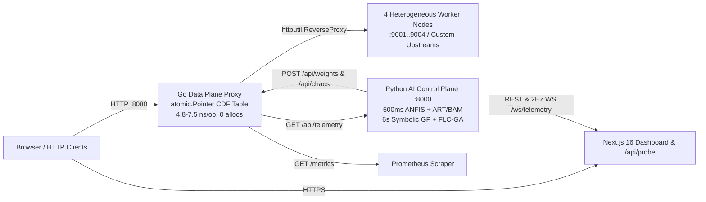
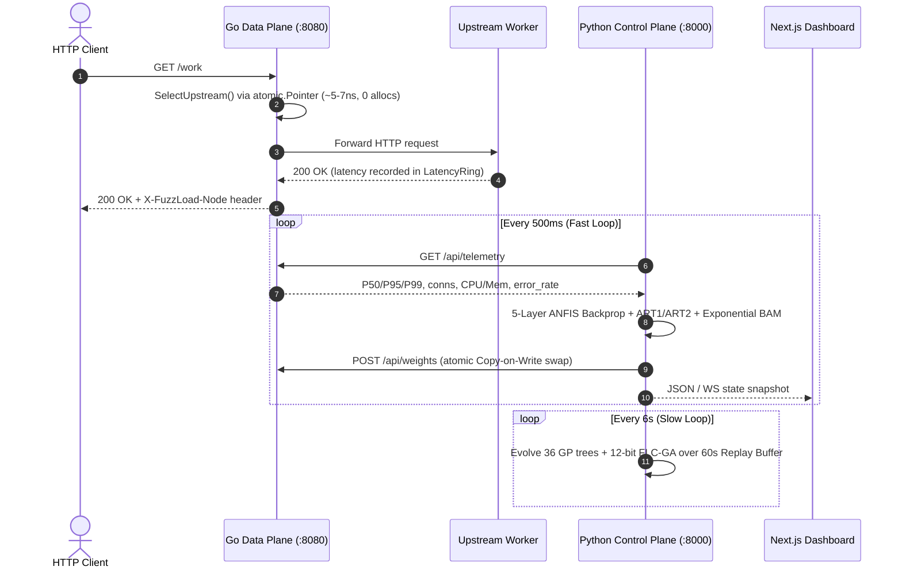
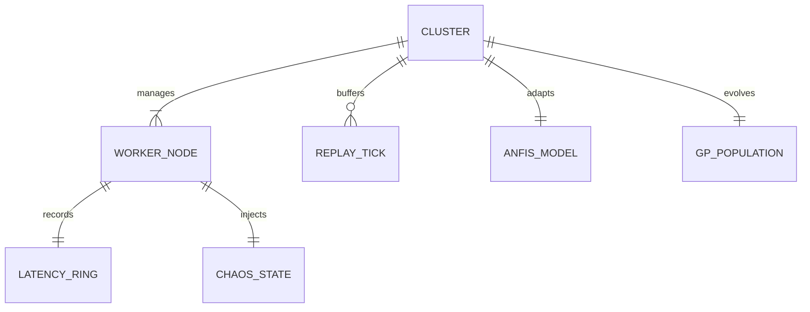

# FuzzLoad — Architecture

---

## 1. Stack & Runtime Versions

| Layer | Technology & Exact Version | Runtime / Region / Notes |
|---|---|---|
| Frontend Dashboard | Next.js 16 (App Router) · React 19 · TypeScript · Tailwind CSS 3 · Recharts 3 | Node 22.x · Vercel (`bom1`) · `frontend/vercel.json` security headers |
| Data Plane & Go SDK | Go 1.23 (`net/http/httputil.ReverseProxy` · `sync/atomic.Pointer` · `LatencyRing`) | Published at `proxy-go/pkg/fuzzload@v1.0.1` (`4.8–7.5 ns/op`, `0 allocs/op`) |
| AI Control Plane & Python SDK | Python 3.12 · FastAPI · Pydantic · Uvicorn · Pure-Python 5-Layer ANFIS, Symbolic GP & ART/BAM | Installable package `fuzzload` + CLI `fuzzload start \| probe \| bench` |
| Testing & Security | `go test -race` · `pytest` · `ruff` · `tsc --noEmit` · Playwright + `@axe-core/playwright` · CodeQL · Gitleaks | Enforced on every push and PR via `.github/workflows/` |
| Hosting & Automation | Vercel (Frontend) · Multi-Stage Docker / Render / EC2 (Backend) · Renovate (`Yantra [bot]`) | Live at `https://fuzzload.tanisheesh.in` |

---

## 2. System Topology & Components



```text
FuzzLoad/
├── proxy-go/                        # Go 1.23 Data Plane SDK & Binary
│   ├── pkg/fuzzload/
│   │   ├── router.go                # Lock-free atomic.Pointer routing table + AdminHandler + http.Handler
│   │   ├── telemetry.go             # Lock-free [128]atomic.Uint64 LatencyRing + /metrics
│   │   ├── health.go                # Passive circuit breaker + half-open recovery + /healthz prober
│   │   ├── adaptive.go              # Standalone pure-Go Gaussian Neuro-Fuzzy + GP loop
│   │   ├── worker.go                # Configurable heterogeneous worker simulator
│   │   ├── doc.go                   # Package GoDoc overview
│   │   └── router_test.go / example_test.go
│   └── cmd/fuzzload-proxy/main.go   # CLI entrypoint (--port, --upstreams, --policy, --standalone-auto)
├── backend/                         # Python 3.12 FastAPI Control Plane & SDK
│   ├── fuzzload/__init__.py         # Public SDK export (`from fuzzload import FuzzLoadRouter`)
│   ├── app/
│   │   ├── main.py                  # FastAPI REST + WebSocket + DNS-pinned SSRF-hardened /api/proxy/probe
│   │   ├── cli.py                   # `fuzzload start | probe | bench` + `FuzzLoadRouter`
│   │   ├── ai_engine/               # `anfis.py`, `gp_optimizer.py`, `art_bam_memory.py`
│   │   └── cluster/simulator.py     # Bidirectional Go sync + Digital Twin replay buffer
│   └── tests/test_fuzzload.py       # Unit, integration, chaos, bidirectional sync & SSRF tests
├── frontend/                        # Next.js 16 App Router Dashboard
│   ├── vercel.json                  # Edge security headers (HSTS, X-Frame-Options, nosniff)
│   ├── playwright.config.ts         # Desktop (1280x800) & Mobile (375x812) Playwright config
│   ├── tests/e2e/smoke.spec.ts      # E2E route smoke, overflow & WCAG AA axe-core checks
│   └── src/
│       ├── app/                     # `/`, `/dashboard`, `/playground`, `/how-it-works`, `/api/probe`
│       ├── components/              # `Navbar.tsx`, `Footer.tsx`
│       └── lib/fuzzload-engine.ts   # Typed schemas + client-side Digital Twin fallback
└── bench/                           # Reproducible Digital Twin & --live-go socket benchmarks
```

### Go Reverse Proxy & SDK (`proxy-go/`)
Handles hot-path HTTP forwarding with zero locks and zero heap allocations on `SelectUpstream()`. Stores per-request latency samples in a fixed `[128]atomic.Uint64` ring buffer so sorting only executes on `/api/telemetry` or `/metrics` scrape. Supports standalone pure-Go Neuro-Fuzzy + GP adaptation (`StartAutoControlLoop`) or external Python control-plane weight injection via authorized `AdminHandler()`.

### Python AI Control Plane (`backend/`)
Runs two cooperative soft-computing loops out of band:
1. **Fast Loop (`500ms`):** Pulls live socket telemetry from Go (`GET /api/telemetry`, falling back to its Digital Twin simulator when Go is offline), runs 5-layer Takagi-Sugeno ANFIS online momentum backpropagation + `ART1`/`ART2` regime clustering + `Exponential BAM` prior recall, and pushes updated weights via `POST /api/weights`.
2. **Slow Loop (`6s`):** Evaluates 36 symbolic GP expression trees + a 12-bit Bitwise FLC-GA chromosome across the 60-second telemetry replay buffer, applying structural rule masks and promoting elite formulas only when simulated fitness improves.

### Next.js 16 Observability & Playground UI (`frontend/`)
Renders `/`, `/dashboard`, `/playground`, and `/how-it-works`. Polls the FastAPI backend when live (`CONTROL PLANE: LIVE (:8000)` + `DATA PLANE: GO PROXY (:8080)`) and degrades gracefully to the in-browser Digital Twin engine when backend containers sleep.

---

## 3. End-to-End Request & Control-Loop Flow



1. **Request Arrival & Target Selection:** Incoming requests hit the Go Reverse Proxy (`:8080`), which loads the current `atomic.Pointer[routingTable]` snapshot in `~4.8–7.5 ns` (`0 allocs/op`) and forwards to the chosen upstream via `httputil.ReverseProxy` (returning `503` if all nodes are offline/tripped).
2. **Hot-Path Telemetry Capture:** On response completion, `ServeHTTP`'s deferred accounting writes elapsed microseconds into `UpstreamNode.Latency` (`[128]atomic.Uint64`) and updates passive circuit-breaker state (`statusCaptureWriter` implements `Unwrap()` to keep WebSocket/SSE upgrades intact).
3. **Fast-Loop ANFIS + ART/BAM (`500ms`):** The Python Control Plane pulls `GET /api/telemetry` from Go (or steps its internal Digital Twin), computes 5-layer ANFIS scores + online momentum backpropagation + `ART1`/`ART2` regime matching + `Exponential BAM` recall.
4. **Slow-Loop Symbolic GP + FLC-GA (`6s`):** Every 12 ticks, 36 candidate syntax trees and a 12-bit structural rule mask evolve against the rolling 60-second telemetry replay buffer.
5. **Atomic Publication & UI Broadcast:** EMA-smoothed weights are pushed to Go (`POST /api/weights`, authenticated via `FUZZLOAD_ADMIN_TOKEN` or loopback) and streamed to `/dashboard` at `2 Hz`.

---

## 4. State Model & In-Memory Ring Buffers

FuzzLoad intentionally uses bounded lock-free in-memory data structures rather than an external SQL database to preserve sub-microsecond hot paths and `$0/mo` deployment:



| Structure | Capacity / Bounds | Concurrency / Access | Purpose |
|---|---|---|---|
| Go `LatencyRing` | `128` `atomic.Uint64` µs slots/node | O(1) lock-free atomic write; sorted on scrape | Rolling per-node `P50`, `P95`, `P99` without request-path sorting |
| Go `routingTable` | `N` healthy nodes + prefix-sum CDF | `atomic.Pointer` Copy-on-Write swap | Zero-lock, zero-allocation target selection |
| Python `replay_buffer` | `120` ticks (`60s` @ `2 Hz`) | Bounded FIFO slice | Offline Digital Twin fitness evaluation for GP generations |
| Python `metrics_history` | `45` ticks | Bounded FIFO slice | Real-time P95 latency & fairness trend charts in `/dashboard` |
| `ART2` & `Exponential BAM` | Dynamic prototypes (`ρ = 0.86`) + stress/weight pairs | In-process fast-loop lookup | Workload regime clustering and one-shot weight recall |

---

## 5. Caching, State & Concurrency Control

- **Zero-Lock Hot Path:** Go `Proxy.table` is an `atomic.Pointer[routingTable]`. Control-plane writes (`UpdateWeights`, `SetNodeChaos`, circuit-breaker transitions) build a new immutable `routingTable` under `updateMu` and atomically swap the pointer without stalling readers.
- **EMA Weight Smoothing:** Target weights blend via Exponential Moving Average (`alpha = 0.45–0.48`) to prevent herd oscillation across worker nodes.
- **Passive + Active Circuit Breaking:** Three consecutive 5xx/transport failures trip a node's circuit for a `5s` cooldown; a scheduled recovery timer (`scheduleRecoveryRefresh`) and optional `/healthz` prober admit a half-open probe on expiry, immediately restarting cooldown if the probe fails.

---

## 6. Soft-Computing & Algorithmic Pipeline

| Subsystem | Role & Mathematical Formulation | Timescale |
|---|---|---|
| **McCulloch-Pitts Gate & BPN XOR Detector** | Binary safety cutoff (`Inhibitory=1 -> 0%`) + 2-layer BPN detecting `CPU XOR Latency` I/O contention mismatches | Per-tick (`500ms`) |
| **5-Layer Differentiable ANFIS** | Layer 1 Gaussian + asymmetric LR-Type sets ($\mu(x) = \exp(-(x-c)^2 / 2\sigma^2)$) → Layer 2 product T-norm → Layer 3 normalized firing $\bar{w}_k$ → Layer 4 Takagi-Sugeno linear consequents + Mamdani Centroid → Layer 5 Momentum BPN ($\eta=0.015$, $\beta=0.35$) | Fast Loop (`500ms`) |
| **ART1 / ART2 & Exponential BAM** | `ART1` 4-bit binary fault vigilance (`ρ=0.70`), `ART2` continuous Delta-Rule clustering (`ρ=0.86`), and Wang et al. Exponential BAM heterocorrelator recall (`γ=2.4`) | Fast Loop (`500ms`) |
| **Symbolic GP & Bitwise FLC-GA** | 36 syntax trees (`max_depth=4`, protected operators `+`, `-`, `*`, `protected_div`, `min`, `max`, `protected_exp`, `protected_sqrt`, `square`) + 12-bit FLC-GA chromosome (bitwise crossover, inversion, deletion/flip) scored on 60s replay buffer | Slow Loop (`6s`) |
| **Pure-Go Standalone Auto-Tuner** | 9-rule Gaussian Takagi-Sugeno scorer + symbolic GP expression running natively inside `pkg/fuzzload` (`StartAutoControlLoop`) when deployed without Python | Standalone (`500ms`) |

---

## 7. API Contracts

| Plane | Method | Route | Auth & Constraints | Responses |
|---|---|---|---|---|
| Control (`:8000`) | `GET` | `/api/health` | Public | `200` control-plane & Go link status |
| Control (`:8000`) | `GET` | `/api/state` | Public | `200` full cluster, ANFIS, GP, ART/BAM snapshot |
| Control (`:8000`) | `POST` | `/api/config/algorithm` | Enum of 5 policies | `200` updated state · `400` invalid policy |
| Control (`:8000`) | `POST` | `/api/config/traffic` | `base_rps` `60..1500` | `200` · `400`/`422` out of bounds |
| Control (`:8000`) | `POST` | `/api/chaos/inject` | Valid `node_id` & `fault_type` | `200` (syncs to Go `POST /api/chaos`) · `400` |
| Control (`:8000`) | `POST` | `/api/gp/evolve` | `generations` `1..20` | `200` evolved formula & FLC-GA mask · `422` |
| Control (`:8000`) | `POST` | `/api/proxy/probe` | Max 8 targets, 10 reqs; DNS-pinned SSRF + TLS 1.2+ | `200` measured weights · `400` blocked URL |
| Control (`:8000`) | `WS` | `/ws/telemetry` | `2 Hz` stream | JSON telemetry frames |
| Edge (`frontend`) | `POST` | `/api/probe` | Max 8 targets, 10 reqs; DNS-pinned SSRF + no redirect | `200` probed P50/P95 + ANFIS/GP share · `400` |
| Data (`:8080`) | `GET` | `/api/telemetry` | Public / internal | `200` live node snapshots |
| Data (`:8080`) | `POST` | `/api/weights` & `/api/chaos` | `Bearer FUZZLOAD_ADMIN_TOKEN` or loopback | `200` atomic swap · `401` unauthorized · `400` |
| Data (`:8080`) | `GET` | `/metrics` | Public / Prometheus | `200 text/plain` Prometheus exposition |

---

## 8. Security Controls

- **Boundary Validation:** All FastAPI request payloads validate via Pydantic models (`ge`/`le` bounds); `/api/probe` enforces explicit target (`<= 8`) and burst (`<= 10`) caps.
- **DNS-Pinned SSRF Defense:** Both `frontend/src/app/api/probe/route.ts` and `backend/app/main.py` resolve hostnames before connecting, reject loopback (`127.0.0.0/8`, `::1`), RFC1918 private networks (`10/8`, `172.16/12`, `192.168/16`), link-local/cloud metadata (`169.254.0.0/16`, `metadata.google.internal`), IPv4-mapped IPv6 (`::ffff:7f00:1`), `.local`/`.internal` hosts, embedded credentials, and HTTP 3xx redirects, then connect directly to the validated pinned IP (with TLS 1.2+ SNI).
- **Admin Route Protection:** Mutating Go proxy routes (`POST /api/weights`, `POST /api/chaos`) enforce constant-time `Bearer FUZZLOAD_ADMIN_TOKEN` verification (or loopback restriction when unset) and can be isolated on a dedicated internal listener via `Proxy.AdminHandler()`.
- **CORS & HTTP Headers:** FastAPI restricts origins via `CORS_ORIGINS`; `frontend/vercel.json` enforces `X-Content-Type-Options: nosniff`, `X-Frame-Options: DENY`, `Referrer-Policy`, `Permissions-Policy`, and `Strict-Transport-Security`.
- **Safe Symbolic Evaluation:** GP trees execute strictly over whitelisted protected operators — `eval()` is never called on arbitrary strings.

---

## 9. Error Handling, Reliability & Observability

| Failure Mode | System Behavior | Logged / Alerted |
|---|---|---|
| Upstream returns 5xx or transport timeout | `ServeHTTP` deferred handler increments `ErrorsCount` once; trips passive circuit after 3 failures | `fuzzload_node_errors_total` & `fuzzload_node_circuit_open` on `/metrics` |
| All upstream nodes offline / tripped | `SelectUpstream()` returns `nil`; `ServeHTTP` responds `503 Service Unavailable` | Critical banner in `/dashboard` narrator |
| Half-open recovery probe fails | Circuit immediately restarts cooldown deadline and refreshes atomic routing table | Node remains excluded during fresh cooldown |
| Go proxy unreachable from Python | Control plane switches `telemetry_source` to `"digital_twin"` seamlessly | Debug log + dashboard badge update |
| SSRF / private destination probed | Rejected prior to outbound socket creation with `400` / `Blocked` | Zero internal network exposure |
| SIGTERM received by Go proxy | `main()` waits for `srv.Shutdown` channel (`3s` deadline) before exit | Graceful completion of in-flight requests |

---

## 10. Performance Budgets & Scale Ceilings

| Parameter / Limit | Current Configured Value | What Breaks at 10x / 100x Load | Next Scaling Step |
|---|---|---|---|
| Go `SelectUpstream()` | `4.8–7.5 ns/op`, `0 allocs/op` (`~133M ops/sec` across 4 cores) | OS TCP socket & file-descriptor limits (`ulimit -n`) saturate long before router CPU | Tune Linux kernel TCP stack or move L4 path to eBPF/XDP |
| Control-Plane Weight Sync | `500ms` HTTP JSON poll (`GET /api/telemetry` + `POST /api/weights`) | Cluster size `> 200` nodes increases JSON serialization & ANFIS matrix time | Switch sync to streaming gRPC protobufs + vectorized native kernels |
| Digital Twin Replay Buffer | `120` ticks (`60s`) in RAM | Very large clusters (`> 500` nodes) increase replay memory footprint | Partition GP evaluation per availability zone or sample top-K nodes |
| Render Free Tier Container | `512 MB RAM`, sleeps after `15m` idle | Cold start (~25s) on first live API hit | Keep live UI resilient via client Digital Twin or move to AWS EC2 `t4g.small` |

---

## 11. Explicit Scope Cuts

- **Kernel-space eBPF packet routing** — Excluded from current scope to remain compatible with unprivileged containers on Render and Docker Desktop.
- **External TimescaleDB telemetry persistence** — Excluded from current scope to keep read/write latency sub-microsecond and hosting `$0/mo`.

---

<div align="center">

<h3>Tanish Poddar</h3>

<a href="https://tanisheesh.in"></a>
<a href="https://linkedin.com/in/tanisheesh"></a>
<a href="https://github.com/tanisheesh"></a>
<a href="mailto:hi@tanisheesh.in"></a>

</div>
